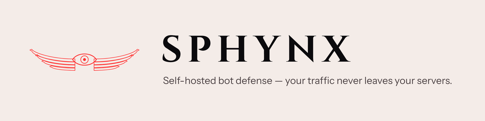

<picture>
  <source media="(prefers-color-scheme: dark)" srcset="https://raw.githubusercontent.com/sphynxHQ/.github/main/profile/assets/banner-dark.png">
  <source media="(prefers-color-scheme: light)" srcset="https://raw.githubusercontent.com/sphynxHQ/.github/main/profile/assets/banner-light.png">
  
</picture>

### Self-hosted bot defense

Your traffic, your visitors' fingerprints and your thresholds never leave your servers.

Open code, private weights: fork it, train your own model, self-host every piece — or point it
at our hosted scorer.

**Status: pre-launch.** The site is live at [sphynx.site](https://sphynx.site). The scoring
service, widget and XDP layer land with the first release.

| Repository | What it is |
|---|---|
| [landing](https://github.com/sphynxHQ/landing) | The pre-launch site at sphynx.site |
| [sphynx](https://github.com/sphynxHQ/sphynx) | The product — service, widget, XDP (opens at launch) |
| [models](https://github.com/sphynxHQ/models) | Training and eval code, feature schema |

Security reports: see [SECURITY.md](https://github.com/sphynxHQ/.github/blob/main/SECURITY.md) —
please do not open a public issue for a vulnerability.

Contact: [help@sphynx.site](mailto:help@sphynx.site)
